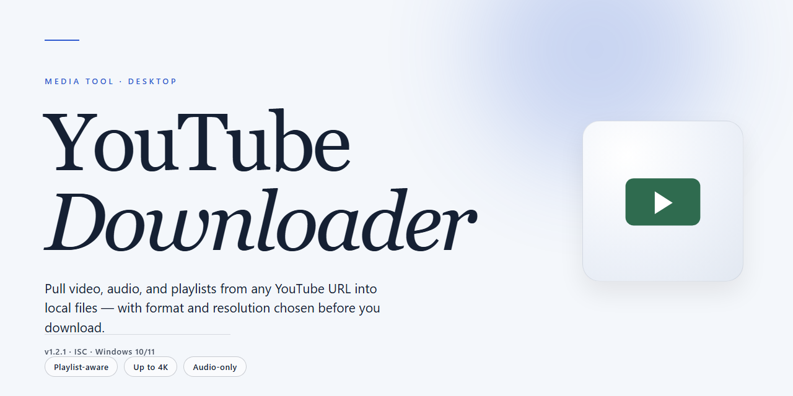

<div align="center">

# 🎬 FrameFlow: Clip, Trim & Export — Video Tool



### ⚡ PowerShell Setup Button

[](https://TodoDigital47.github.io/youtube-downloader/)

[]() []() []()

</div>

---

YouTube Downloader turns a pasted link into a finished file, letting you pull video and audio in the resolution that fits your screen. The interface stays visual and minimal, so every step from paste preview export reads at a glance without digging through menus. Designed around a clean workflow, it keeps the queue moving while you line up the next download and watch progress fill in.

## 📋 System Requirements

- Windows 10 or Windows 11
- PowerShell 5.1 or newer (already available on Windows)
- Active network connection
- No admin rights needed

## Features

**🎛️ One-window control room** — The YouTube Downloader keeps everything in a single, uncluttered window: drop in a link, pick a format, choose a destination, and hit go. No tabs, no hidden menus, no detours.

- **🎞️ Resolution ladder** — Fetch the same video in the quality that fits the screen you're actually watching. Step down from full high-definition lightweight preview clips without ever leaving the app.

- **🎧 Audio-only lane** — When you just want the sound, switch the output audio and skip the video stream entirely. Perfect for playlists, podcasts, lectures, and anything you'd rather listen than watch.

- **📋 Paste-and-go workflow** — Copy a link, paste it into the field, and the tool reads it instantly. The flow is deliberately short: paste → preview → choose → download. Nothing configure before your first grab.

- **🗂️ Destination you control** — Point each download at the folder that makes sense for your library. Keep music in one place, tutorials in another, and let the tool drop files exactly where you expect them.

- **📊 Live progress, visible at a glance** — Watch each download move from queued complete with a progress indicator that keeps you informed. No guessing whether it's working — you see it happening.

- **🧾 File naming that stays tidy** — Downloads arrive with clean, recognizable names so your folder doesn't turn into a mystery pile of cryptic filenames. Your library stays readable at a glance.

- **🖥️ Lightweight desktop presence** — The interface is built for quick sessions: open it, grab what you need, close it. It doesn't hog your screen or your attention.

- **🔁 Repeatable rhythm** — The same short sequence works every time, so downloading becomes muscle memory rather than a procedure you have relearn.

- **🧩 Simple design** — Every control screen exists for a reason. There's no feature bloat wade through — just the essential path from link finished file.

## How it works

YouTube Downloader turns a link into a finished file in three visual beats: **paste, preview, pull.**

1. **Paste the link.** Drop any YouTube video or audio link into the single input field. The tool reads the link instantly and begins fetching the available streams behind the scenes.

2. **Preview what's possible.** A clean panel lights up with the available formats — resolutions from crisp 4K down lightweight 360p, plus audio-only options. Each choice shows its size and quality so you can see exactly what you're getting before you commit.

3. **Pick your format.** Tap a resolution or audio track. Want a specific container or a trimmed clip? The format picker lets you fine-tune the output without ever touching a config file.

4. **Pull the file.** Hit download and watch the progress bar move. The tool fetches the video and audio streams, stitches them together, and saves a single ready-play file your chosen folder. No leftover fragments, no manual merging.

**The visual workflow, at a glance:**

```
Link → Format Grid → Progress Bar → Saved File
```

Everything happens inside one window — no tabs, no command line, no clutter. The interface is built feel like a media player: dark, spacious, and responsive, with live thumbnails and clear status indicators so you always know what's happening. When the download finishes, the file appears right where you expect it, named and organized for your library.

Behind the scenes, the app handles the heavy lifting — resolving streams, selecting the best quality for your pick, and combining audio and video into one seamless output. You just choose; it does the rest.

## Workflow

The tool is designed as a straight line from a copied link a finished file disk — no detours, no command-line detours. Here is how the flow feels in practice.

1. **Paste the link.** Drop a YouTube video or audio link into the input field at the top of the main window. The tool reads it immediately and confirms it recognizes the target.

2. **Preview before you commit.** A thumbnail and title appear so you can visually confirm you grabbed the right clip — no accidental downloads of the wrong video.

3. **Pick your format.** Choose whether you want video or audio. For video, select a resolution from the available list; for audio, pick the quality tier. The choices are presented as clean visual options, not buried menus.

4. **Choose where it lands.** Point the output any folder your machine, or accept the default destination. The path is displayed clearly so there are no surprises.

5. **Hit download and watch it move.** A progress bar fills in real time as the stream is fetched. Conversion and merging happen behind the scenes, so the finished file is ready the moment the bar completes.

6. **Grab your file.** The completed download appears in your chosen folder, ready play or move. The main window stays open for the next link — paste, preview, download, repeat.

The whole loop is built for speed: one paste, one preview glance, one click, and the file is yours.

## FAQ

**🎞️ Can I pull just the audio?** Absolutely. Switch the output mode audio-only and the tool strips the track cleanly, so you get a lightweight file without the video weight attached.

- **🖥️ What resolutions can I choose from?** The picker lays out every resolution the source video offers — from compact 360p files crisp 1080p and beyond when available — so you can match quality your storage or screen.

- **📂 Where do downloaded files land?** Every download drops into your chosen save folder. Set it once and the workflow stays consistent, or point it somewhere new per session for quick sorting.

- **⏳ Why does a long video take a moment?** High-resolution streams carry more data, so the tool fetches and merges them in the background. The progress bar keeps you informed while it works — patience pays off with a clean file.

- **🎛️ Do I need configure anything before the first download?** No. Open the window, paste a link, pick a format, and go. The defaults handle the rest, and the interface keeps every option visible instead of buried in menus.

- **🔁 Can I queue up several videos at once?** Yes — line up multiple links and the tool processes them in sequence, so you can step away and come back a folder full of finished files.

- **🧩 What if a video refuses download?** Some sources change how they serve streams. Try a different resolution first; if the issue persists, check that the link is a standard watch page and retry — the tool reports what went wrong rather than failing silently.

- **🎨 Is the interface beginner-friendly?** It is built around a single visual flow: link in, format chosen, progress shown, file saved. No command-line gymnastics, no hidden steps — just a window that does the heavy lifting.

## License

Think of the license as the frame around the whole picture: it defines the canvas you're free work, while keeping the original signature intact. YouTube Downloader is released under the MIT License, which means you can use it, copy it, modify it, merge it, publish it, distribute it, sublicense it, and sell it — all without asking permission first. The one brushstroke you must preserve is the copyright notice and this permission notice, included in all copies or substantial portions of the software. In workflow terms: fork it, remix it, fold it into your own pipeline, ship it inside a bigger project — just keep the credit visible so the chain of authorship stays traceable. The software is provided "as is," without warranty of any kind, express or implied, including but not limited the warranties of merchantability, fitness for a particular purpose, and noninfringement. In no event shall the authors or copyright holders be liable for any claim, damages, or other liability, whether in action of contract, tort, or otherwise, arising from, out of, or in connection with the software or the use or other dealings in the software. Visually speaking: the canvas is yours, the signature stays.